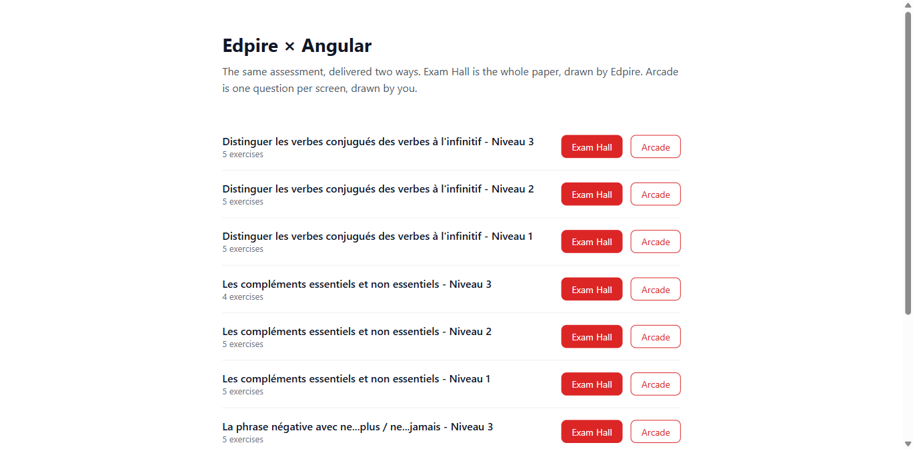
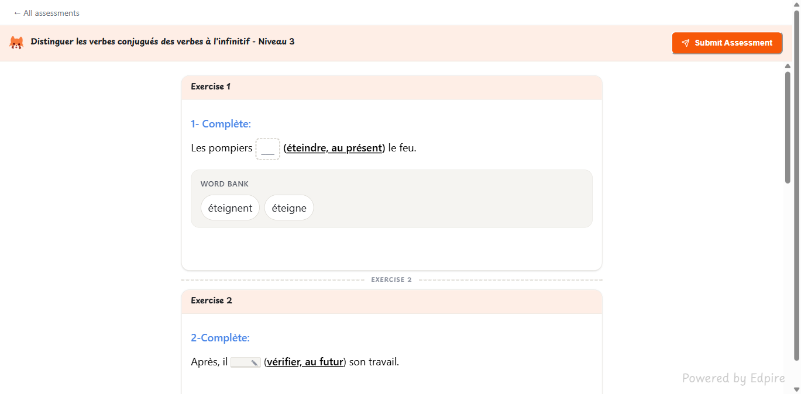
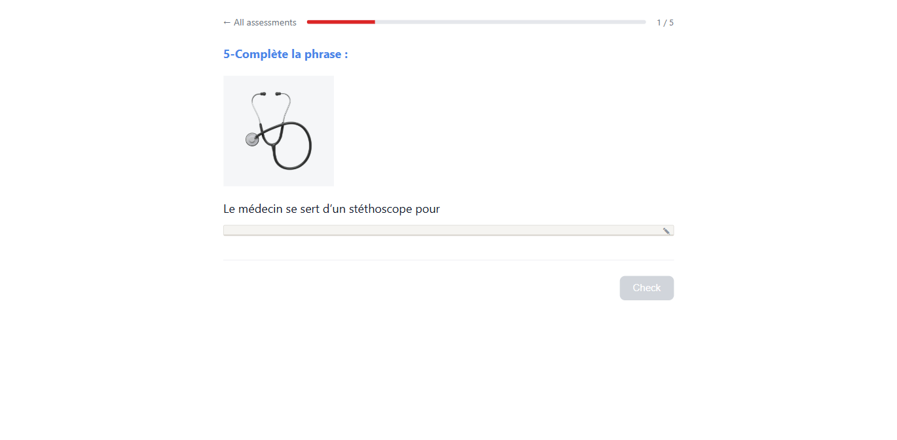
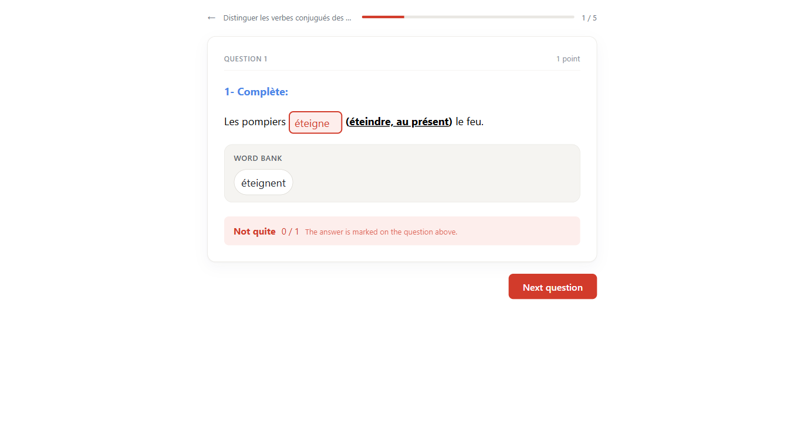
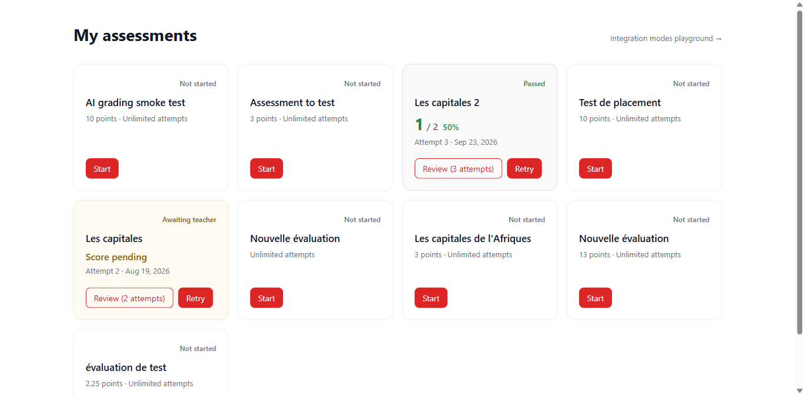
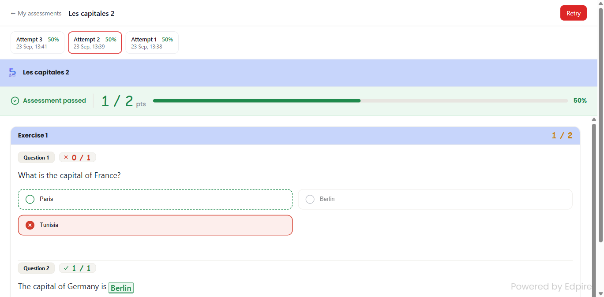
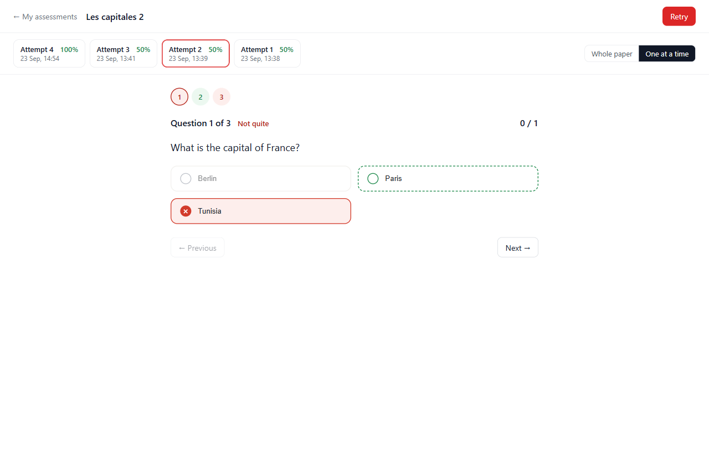
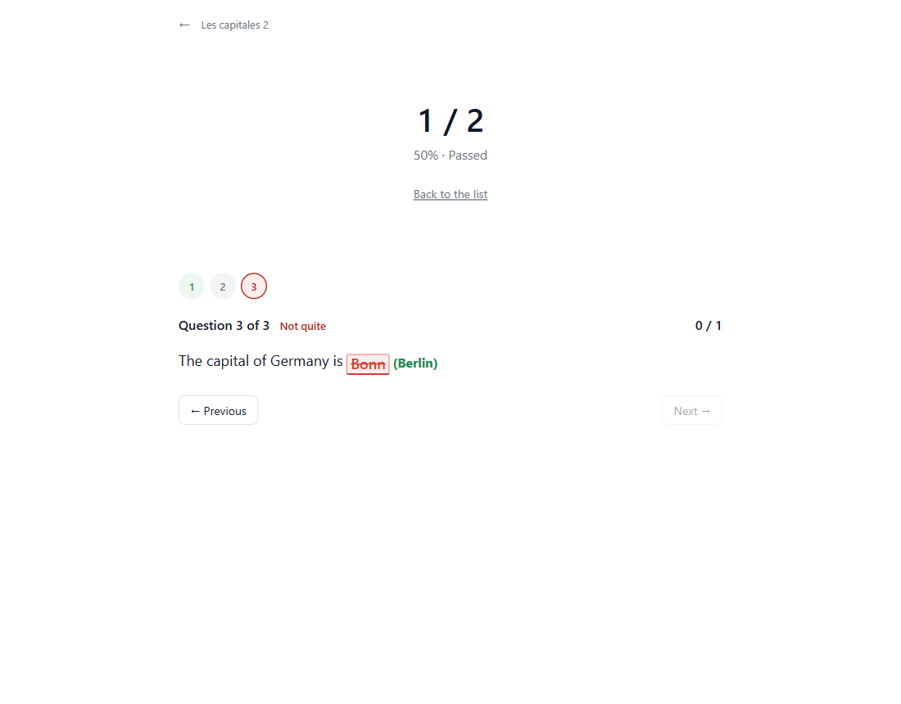

# Edpire + Angular

A minimal, working example of embedding [Edpire](https://edpire.com) assessments in an Angular app: a learner's assessments as cards, with retry and a review of every past attempt, plus both shapes an integration can take.

**My assessments**: every assessment as a card. Not started, finished with a score, or awaiting a teacher. Retry any of them, or reopen any past attempt as the corrected paper.

**Exam Hall** — Edpire draws the whole paper. One component, one tag, done in an afternoon.
**Arcade** — you draw the screen, one question at a time, in any order you like. Progress bars, hearts, streaks, pacing: yours. And afterwards, back through the attempt question by question.

Same assessment, same catalogue, same results, same webhooks. Only who draws the screen changes.

<table>
<tr>
<td width="25%"></td>
<td width="25%"></td>
<td width="25%"></td>
<td width="25%"></td>
</tr>
<tr>
<td align="center"><sub><b>1.</b> Pick by title, not by ID</sub></td>
<td align="center"><sub><b>2.</b> Exam Hall: the whole paper</sub></td>
<td align="center"><sub><b>3.</b> Arcade: one question at a time</sub></td>
<td align="center"><sub><b>4.</b> Marked, with the answer key</sub></td>
</tr>
</table>

Screens 2 to 4 are the Edpire SDK. You write screen 1 and about two hundred lines of server code.

<table>
<tr>
<td width="50%"></td>
<td width="50%"></td>
</tr>
<tr>
<td align="center"><sub><b>5.</b> My assessments: each card knows where the learner stands</sub></td>
<td align="center"><sub><b>6.</b> Every past attempt, reopened as the corrected paper</sub></td>
</tr>
<tr>
<td width="50%"></td>
<td width="50%"></td>
</tr>
<tr>
<td align="center"><sub><b>7.</b> Or one question at a time, any attempt</sub></td>
<td align="center"><sub><b>8.</b> Arcade: back through the attempt you just played, in the same order</sub></td>
</tr>
</table>

---

## What is in here

```
server/   your backend's Edpire routes, ~450 lines of Node   <- your API key lives here
app/      the Angular app                                    <- never holds an API key
```

These files are the entire integration, and they are worth reading in this order:

| File | What it does |
|---|---|
| `app/.../edpire/edpire-sdk.types.ts` | Types for the CDN global. Hand-written, zero dependencies |
| `app/.../edpire/edpire-sdk.service.ts` | Loads the CDN bundle once, lazily |
| `app/.../edpire/edpire-api.service.ts` | Every call to *your* backend. No API key, no learner ID |
| `app/.../edpire/edpire-assessment.component.ts` | **Exam Hall in one component.** Copy this file into your app |
| `app/.../edpire/edpire-review.component.ts` | **A past attempt, as the corrected paper.** Copy this one too |
| `app/.../edpire/edpire-review-steps.component.ts` | **A past attempt, one question per screen.** And this one |
| `server/attempts.mjs` | **Your attempts table, kept in step with Edpire, turned into cards** |
| `app/.../pages/library.component.ts` | The cards |
| `app/.../pages/attempts.component.ts` | One assessment's history, the review, and Retry |
| `app/.../pages/arcade.component.ts` | **Arcade.** One question per screen, shuffled if you want |

**`server/` is not a service you deploy.** In your real product it is four routes inside the backend you already have, sitting next to the session they read the learner from. It is a separate folder here only because this example has no existing app to put them in.

---

## Angular does not need npm for this

The `@edpire/sdk` npm package is built for React and declares `react` and `react-dom` as peer dependencies. **Do not install it in an Angular app.**

Use the CDN bundle instead. It carries its own React sealed inside a closure, so:

- your framework is irrelevant to it,
- your build configuration is irrelevant to it,
- it does not touch `window.React`, so it cannot collide with anything,
- there is no npm install, no bundler shim, no `allowSyntheticDefaultImports`.

This is the supported path for Angular, not a fallback. Vue, Svelte, Rails, Django and plain HTML all use the same bundle.

```ts
// The whole "installation", in edpire-sdk.service.ts
const script = document.createElement('script')
script.src = 'https://cdn.jsdelivr.net/npm/@edpire/sdk@0.12.1/dist/umd/index.global.js'
document.head.appendChild(script)
// -> window.EdpireSDK
```

`edpire-sdk.types.ts` gives that global a full TypeScript surface, so `strict: true` and `strictTemplates` stay on. Nothing in this repo uses `any`.

---

## Run it

**Prerequisites:** Node 20.6+, an Edpire API key, and one published assessment.

### 1. Start the server

```bash
cd server
npm install
cp .env.example .env      # paste your EDPIRE_API_KEY into it
npm start
```

The key needs three scopes: `read:assessments`, `write:submissions` and `read:results`. Exam Hall works on `read:assessments` alone, so a read-only key looks fine right up until an Arcade attempt ends and the final submit returns 403. `read:results` is what the cards, the history and the review read from.

On start it prints the published assessments it can see, which is the quickest way to confirm your key works:

```
Published assessments (showing up to 10):
  a63c2173-0792-4178-9219-b9c498c5c40c  Les compléments essentiels - Niveau 3
  4f2bbd6e-02b8-43fc-8f83-c04915d8602c  Distinguer les verbes conjugués - Niveau 2
```

If that list is empty, create and publish an assessment in Edpire first. Drafts never appear.

### 2. Allow-list `http://localhost:4200` — do this before step 3

Open Edpire, go to **Integrations → Origins**, and add every origin the player will run on:

```
http://localhost:4200          <- the Angular dev server. Yes, really, add it
https://staging.yourapp.com
https://app.yourapp.com
```

**Skip this and the player shows "Origin not allowed" on your very first run.** See [The origin allow-list](#the-origin-allow-list) below for why, and why it does not apply to the server routes.

### 3. Run the app

```bash
cd app
npm install
npm start                 # http://localhost:4200
```

The dev server proxies `/api` to the token server on `:8787` (`proxy.conf.json`), so the browser sees a single origin and there is no CORS between your app and your backend.

---

## My assessments: cards, retry, review

The screen most products want first. Every assessment is a card, and every card knows where this learner stands:

| Card | Shows | Buttons |
|---|---|---|
| **Not started** | Points, attempts allowed | Start |
| **Finished** | The latest score, and the best when it differs | Review, Retry (unless no attempts are left) |
| **Awaiting teacher** | "Score pending": open responses are not marked yet | Review |

**Review** opens the assessment's history: one tab per attempt, and below it the selected attempt exactly as the learner saw it on submitting, either as the **whole paper** or **one question at a time** (a switch on the page, kept in the URL as `?view=steps`). Their answers, locked, each one marked, the expected answer on anything missed, and the teacher's comments once they arrive. **Retry** is just Start again: every token is a new attempt, and Edpire numbers it and enforces the limit.

### The whole design in two sentences

**Store the numbers. Fetch the paper.** Your backend keeps one small table of attempts (who, which assessment, the score) and builds every card from it. When a learner opens a past attempt, your backend asks Edpire for that one attempt and the SDK draws it.

| | Kept by | Why |
|---|---|---|
| Your catalogue, and who the learner is | You | It is your product |
| One row per attempt: score, date, attempt number | You, copied from Edpire | A page of cards costs one query on your database, not an API call per card |
| Questions, answer keys, the learner's answers, the corrections | Edpire | Large, read one attempt at a time, and they change when a teacher marks. Fetched on demand |

The table, as it would be in your database, is at the top of `server/attempts-store.mjs`. Here it is a JSON file so the example runs without one.

### One function writes it, three things call it

`recordAttempt()` in `server/attempts.mjs` takes a submission ID, reads the attempt from Edpire with the API key, and upserts it. Nothing it is handed is trusted, and writing the same attempt twice is harmless.

| Caller | When | Why |
|---|---|---|
| The app, on finish | The player's `(completed)` posts `submission_id` to `POST /api/attempts` | Fast: the card is right when the learner clicks back |
| The webhook | `POST /api/webhooks/edpire`, on `submission.graded` and `submission.grading.completed` | Reliable: covers a closed tab, and is the only path that sees a teacher finish marking |
| A backfill | The first time the server sees a learner | Repair: attempts made before this code shipped |

The browser path passes the signed-in learner as well, so posting somebody else's submission ID gets a 404, not their attempt.

### The review, end to end

```js
// server: ownership first, then Edpire. learnerRef makes a bug in your check a 404.
if (!ownsAttempt(learner, submissionId)) return json(res, 404, { error: "Attempt not found" })
return json(res, 200, await client.getSubmissionReview(submissionId, { learnerRef: learner }))
```

```html
<!-- Angular: one tag, like the player -->
<edpire-review [submissionId]="attempt.submissionId" />
```

Inside, the component calls `EdpireAssessment.review({ review, container })` with the response untouched. There is no token and the browser makes no request to Edpire, so the origin allow-list is not involved. Requires `@edpire/sdk` 0.8.0.

### One question at a time

Same endpoint, same response, different drawing. The SDK turns the review into one step per question and you draw each with `renderQuestion`, locked:

```ts
const steps = sdk.flattenReview(review)   // content, answers, feedback, score, status, sharedContext
sdk.renderQuestion({
  container: el,
  content: steps[i].content,
  initialAnswers: steps[i].answers,
  feedback: steps[i].feedback,            // already in /check's shape: pass it through
  readOnly: true,
})
```

```html
<edpire-review-steps [submissionId]="attempt.submissionId" [order]="questionIdsAsShown" />
```

The dots, the verdict line and Previous / Next are yours; `edpire-review-steps.component.ts` is one way to draw them. It works for any attempt, whichever way it was taken: the attempts page offers it for Exam Hall attempts too.

**Arcade uses it at the end of an attempt.** The finish screen has **Review question by question**, which pages back through the attempt just played. Arcade shuffles, and Edpire does not record the order an attempt was shown in, so the screen passes its own order as `[order]` and the review follows it.

Three details in that component worth copying:

- **A fresh question per step.** `initialAnswers` are read when a question mounts, so `setContent()` would show the next question with no answers in it.
- **The passage comes with the step.** `steps[i].sharedContext` is the exercise's reading text or figure. Draw it above the question, or a comprehension question makes no sense on review.
- **`unscored` is not wrong.** A question worth 0 points has nothing to get wrong. Show it neutral, not red.

### Things this flow will teach you the hard way

**Do not offer "All attempts" until the attempt is recorded.** A learner who clicks straight through lands on a history that does not have the attempt they just made: your table is only as fresh as its last write. `take.component.ts` shows the link once `POST /api/attempts` has returned.

**Never show a score while `is_fully_graded` is false.** With open responses, the score at submit covers only the automatic questions. Show it as final and you will be taking it back when the teacher marks. Hence the "Awaiting teacher" card.

**Re-read the attempt in the webhook; do not store the payload's numbers.** Deliveries arrive late and out of order. Read the header `X-Edpire-Event` for the event name, verify `X-Edpire-Signature` over the raw bytes, answer 200, then read.

**A question worth 0 points must not trap an Arcade learner.** It usually means the question was published with nothing to answer. Check waits for an answer and would never enable, so `arcade.component.ts` shows Next on it instead and still sends its (empty) answer with the attempt.

**Review shows the answers.** A learner can read the corrections and retry for full marks. Fine for practice. For anything that counts, cap attempts in Edpire, or record the first attempt's score.

**Attempts made through the SDK or the REST submit before September 2026 cannot be reviewed.** They were stored without per-question detail. Their scores are intact, and the review endpoint says so with a 409.

### Testing the webhook locally

Edpire cannot reach `localhost`, so either tunnel it (`cloudflared tunnel --url http://localhost:8787`, then register `https://<tunnel>/api/webhooks/edpire` under **Integrations → Webhooks**) or skip it: the other two paths keep the cards correct while you develop. Put the webhook's secret in `server/.env` as `EDPIRE_WEBHOOK_SECRET`; without it the route is off.

The full recommendation, independent of Angular, is in the docs: [Attempt History](https://docs.edpire.com/developer/attempt-history).

---

## Exam Hall, in full

Everything else in this repo is scaffolding. This is the integration:

```html
<edpire-assessment
  [assessmentId]="lesson.edpireAssessmentId"
  (completed)="onScore($event)" />
```

and, on your server:

```js
app.post('/api/edpire/token', toNodeHandler(createEdpireTokenHandler({
  apiKey: process.env.EDPIRE_API_KEY,
  resolveLearner: async (req) => {
    const session = await getSession(req.headers)
    if (!session) return null
    return { ref: session.user.id, name: session.user.fullName, email: session.user.email }
  },
})))
```

That is it. The component mints the token, loads the bundle, mounts the player, and unmounts on destroy.

### Show your learners by name

`resolveLearner` returns the learner's name and email with the ref, and the token handler sends them to Edpire. Teachers then see "Amira Ben Salah" on Edpire's results, statistics and grading screens instead of `demo-learner-001`.

- Both are optional. Return the ref alone, as a string, and nothing changes.
- The name shows on papers already submitted under that ref too, and a new name replaces the old one everywhere.
- The email shows only on the learner's detail in Edpire and in the results CSV.
- It needs `@edpire/sdk` 0.12.1 on the server.
- Names travel only with the token. Arcade's papers take the name the token route last sent for that ref, so a learner who has never opened Exam Hall shows by ref.

### Why a server is required

Your API key must never ship inside the Angular bundle. A bundle is a text file anyone can open, so a key in it is a public key.

Your backend instead mints a **short-lived token**, scoped to one learner and one assessment, expiring in two hours. The browser receives only that.

```
Angular ──POST /api/edpire/token──▶ your server ──▶ Edpire
                                    (holds the API key)
    ◀───────────── { token } ────────────────────────
    │
    └──▶ EdpireAssessment.mount({ token, container })
```

There is a second reason, and it is the one people miss. Something has to answer *"which learner is this?"* in a way the learner cannot forge. If the browser claims to be learner 42, any learner can submit results as any other. That is why the app sends only an assessment ID, never a learner ID.

### Stay in the player after submitting

When the learner submits, the player rewrites itself into the corrected paper: a score banner, per-question marks, and the answer key on anything they missed.

So this example does **not** navigate away in `(completed)`. It records the result and shows a thin bar above, leaving the corrections on screen for as long as the learner wants. Routing away on that callback throws the correction view in the bin, and it is the most common mistake in a first integration.

### White space down both sides

The first thing most people notice. `container` sizes the player's **outer box**; inside that, the questions sit in a column capped at `48rem` (768px) and centred. Two different boxes, and the gutter between them shows *your* page background, because the player paints none of its own.

The cap is a reading measure, not an oversight. At the player's base size 768px already gives roughly 70 to 90 characters per line, the top of the comfortable range; past about `60rem` the eye starts losing its place on the return sweep, which costs a learner more on a long comprehension passage than empty gutters ever will.

Keep it when the player owns the page. Override it when you mount inside your own chrome and your container already supplies the measure:

```html
<edpire-assessment [assessmentId]="id" contentMaxWidth="none" />
```

```typescript
// or, if you call mount() yourself
sdk.EdpireAssessment.mount({ token, container, layout: { maxWidth: 'none' } })
```

Any CSS length works, so `'60rem'` widens the column without giving up the measure entirely. The value also drives the post-submit score banner, so the two stay aligned. Requires `@edpire/sdk` 0.7.0.

The Exam Hall screen has a switch in its header so you can see both. It is a demo control, not a pattern: pick one value and hard-code it, and never wire it to something a learner can reach mid-attempt, because changing it re-mounts the player and a re-mount discards their answers.

> **Still seeing gutters after `none`?** Then they are yours, not ours. Check the computed width of the element you pass as `container`: if your own layout caps it, the player has no room to expand into and this setting changes nothing. Measure before you change anything — in DevTools, select that element and read `offsetWidth`.

### Treat the result callback as a UI hint

It is the fastest way to show a score, and it is a client callback. Record the authoritative result server-side from the [`submission.graded` webhook](https://docs.edpire.com/developer/webhooks). If the assessment contains open responses the first score is provisional: check `awaiting_manual_grading` and wait for `submission.grading.completed`.

---

## Arcade: one question per screen, in any order

`pages/arcade.component.ts` is a complete second integration in ~200 lines. Three SDK calls do the work:

```ts
const steps = sdk.flattenAssessment(assessment)   // flat array, one entry per question
if (shuffle) steps = shuffled(steps)              // ordinary Fisher-Yates. It's your array

const q = sdk.renderQuestion({                    // one question, into a div you own
  container: el,
  content: steps[i].content,
  onAnswersChange: (answers) => (current = answers),
})

q.setFeedback(checkResult.feedback)               // reveal marking after POST /check
q.setContent(steps[++i].content)                  // next question; also clears feedback
```

Everything else on that screen — card, progress bar, result banner, pacing, the shuffle toggle — is ordinary Angular. Replace it with hearts, streaks, a per-question timer or a lesson path; the Edpire side does not change.

Two things in that file are not obvious and are worth copying rather than rediscovering: it mounts a **fresh question per step** rather than reusing one with `setContent()`, and it renders the **exercise's shared context** above the question. Both are explained under [Things that will cost you an hour](#things-that-will-cost-you-an-hour).

### Two different shuffles, don't confuse them

|  | Where it lives | Who does it |
|---|---|---|
| **Question order** | Your `steps` array | You, in one line, as above |
| **Answer options inside a question** (choices, drag-drop pools, matching columns) | The question itself, set by the author in the Edpire editor | Already done. The runtime honours it on every render, in both modes |

The second one you get for free and there is nothing to write. The first one is yours precisely because Arcade means you own the sequence.

Shuffling question order is safe: every entry in the submit payload names its own `exerciseId` and `questionId`, so Edpire grades the attempt identically whatever sequence the learner saw.

### `/check` records nothing

`POST /check` is stateless — it grades one question and creates no submission. The attempt only exists once you call `submit()` at the end. Two consequences:

- If the learner closes the tab mid-flow, the attempt is lost. Consider saving answers to `sessionStorage` after each question.
- `/check` is rate limited to **3 calls per question, per session, per rolling hour**. Generate **one** `session_id` per attempt, not per question — get that wrong and the limit falls back to the learner ref, accumulates across retakes, and 429s a learner who did nothing wrong.

---

## The origin allow-list

Two round trips go from the browser to Edpire directly, rather than through your server: the player fetching its content, and the player submitting. Both are authorised by the embed token — but the browser also has to be on an allow-list, and **origins are matched exactly: scheme, host and port**.

```
http://localhost:4200      ≠   http://localhost:3000
https://app.yourapp.com    ≠   https://www.app.yourapp.com
https://app.yourapp.com    ≠   http://app.yourapp.com
```

A missing origin is the single most common cause of a blank player on launch day. Send the full list up front, including every developer's local port.

**It does not apply to your server.** `server/server.mjs` calls Edpire with an API key and no `Origin` header, so nothing in the allow-list affects it. This is why the Arcade content and check routes work before you have registered anything, and Exam Hall does not — a difference that looks baffling until you see where each request originates.

Native WebViews send no origin, or an opaque one. Both are handled, and there is nothing to register for mobile.

---

## Things that will cost you an hour

Every one of these is already handled in the code. They are listed because each cost real time to find.

**`http://localhost:4200` is not auto-allowed.** Edpire trusts localhost origins on a *development* Edpire instance. Against production it does not, and it cannot: production has no way to know your laptop from anyone else's. Register the port.

**Give the container a width, never a fixed height.** The player is at least as tall as the screen and grows with the paper: the page scrolls and the player's top bar sticks to the top (SDK 0.11.0 and later). A page that is `height: 100vh` with the player in a flex child gives learners two scrollers, and a box with a fixed height and `overflow: hidden` cuts the paper off. Hence `min-height: 100vh` on the pages and no height in `edpire-assessment.component.ts`. A player that must live in a box of its own height (a panel, a modal) needs `overflow: auto` on that box.

**Wrap SDK callbacks in `NgZone.run()`.** `onComplete`, `onError` and `onAnswersChange` originate inside the SDK's own React tree. In a zone.js app they can land outside the Angular zone, and then your UI silently does not update — the classic "the callback fired, I logged it, nothing rendered". In a zoneless app (the Angular 20+ default, and what this example uses) signal writes handle it and `NgZone.run` is a no-op. Wrapping is free in one and saves an afternoon in the other, so wrap.

**Don't template anything inside the mount container.** `renderQuestion()` and `mount()` put a React root in that div. Angular must not manage its children, or the two will fight over the same DOM.

**Load the bundle lazily.** It is around 700 KB gzipped, because it carries React, a maths renderer and a rich-text engine. Put it in `angular.json`'s `scripts` array and every page pays for it. `edpire-sdk.service.ts` fetches it on the screen that needs it, once, cached.

**Pin the SDK version.** `@edpire/sdk` is pre-1.0, so minor releases can change behaviour. `@latest` means your production app changes on someone else's release schedule. `EdpireSdkService.VERSION` pins it. Bump it on purpose.

**Do not page questions with `setContent()`.** It swaps the content and clears the feedback, but it does **not** clear collected answers: the runtime keeps one answer bus for the life of its React root, so `onAnswersChange` keeps reporting every answer that root has ever seen. Page through three questions and the third `/check` is sent the first two questions' answers as well, for nodes that are not on screen. Grading is by node ID so it often still looks right, which is exactly what makes it dangerous — the payloads are wrong long before anything visibly breaks, and the final submit carries the lot. Unmount and mount a fresh question instead. It is one teardown per question, not per keystroke.

**`answers.length > 0` does not mean the learner answered.** Every player emits an answer for its node as soon as it mounts — a typed blank emits `text: ""` on first render. A Check button wired to array length is live on an untouched question, and since `/check` allows three calls per question per session, a learner can burn a third of their allowance on a blank. `edpire/edpire-answers.ts` has the predicate that actually works.

**`flattenAssessment()` returns questions only.** An exercise's shared context — a reading passage, a figure, a worked example — hangs off the exercise, not the question, so it is not in the steps. Drop it and every question in a comprehension exercise becomes unanswerable. Keep the original assessment and look the context up by `exerciseId`; `arcade.component.ts` does.

**Give the question typography; do not restyle its boxes.** The SDK styles what carries meaning — marking colours, blanks, the word bank — and inherits the rest from you on purpose, so questions look like your product. A page with no type scale of its own therefore renders a question with no type scale, which reads as "the SDK is broken" when it is doing exactly what it promises. Set font, colour and line height on the container. Do **not** cap widths: a blank that spans the card is usually the author saying "this answer is a sentence", set per blank in the editor, and a `max-width` silently overrides an authoring decision you cannot see from your side.

**Pass `/check`'s `feedback` through untouched.** The SDK converts it internally. Mapping it yourself is how you get a question that renders blank.

**Set `include_correct_answers` on the server, never from the browser.** It decides whether the response reveals the answer. Read it from the request body and you have handed every learner the key.

**Mount the token handler before any body parser.** `toNodeHandler` reads the request stream itself. If `express.json()` already drained it, the request hangs with no error.

**Exam Hall and Arcade need different key scopes.** Exam Hall's submit is authorised by the embed token, so `read:assessments` is enough for the whole flow. Arcade's final `submit()` is authorised by the API key and needs `write:submissions`. A key that runs Exam Hall perfectly will 403 on the last click of an Arcade attempt, which is the worst possible moment to find out.

**`mediaHandler` is required for file uploads and recordings.** If any question asks for one and you have not passed a handler, that question will not work.

---

## Troubleshooting

| Symptom | Cause |
|---|---|
| "Origin not allowed" | `http://localhost:4200` is not registered. Integrations → Origins, exact match including port |
| The list is empty | Nothing published in your org. Drafts never appear |
| Player area is blank | The bundle did not load. Check the Network tab for `index.global.js` |
| Two scrollbars, or the paper cut off at the bottom | A container with a fixed height around the player. Use `min-height` (SDK 0.11.0 and later) |
| The score is `null` in `onComplete` or in a review | The teacher set the assessment not to show the score to students (SDK 0.12.0). The browser never gets it; your server reads it from `GET /submissions/{id}` |
| Teachers see `demo-learner-001`, not a name | `resolveLearner` returns a string, or the server is on `@edpire/sdk` before 0.12.1 |
| "Failed to connect to Edpire" | Usually an origin problem wearing a network problem's clothes. Check the allow-list first |
| `window.EdpireSDK is undefined` after the script loads | A Content Security Policy allowed the fetch and blocked the execution. Add the CDN to `script-src` |
| Callback fires, UI does not update | Missing `NgZone.run()` in a zone.js app |
| `/check` payload contains nodes from earlier questions | You paged with `setContent()`. Mount a fresh question per step |
| Check button live on an untouched question | You tested `answers.length`, not answer content. See `edpire-answers.ts` |
| A reading passage is missing in Arcade | It lives on the exercise, not the question. `flattenAssessment()` does not carry it |
| 429 from `/check` | One `session_id` per attempt, not per question |
| "This API key does not have the 'write:submissions' scope" | Arcade's final submit needs it. Exam Hall does not, because the embed token authorises that one |
| Score looks wrong / too low | The assessment has open responses. Check `awaiting_manual_grading` and wait for the webhook |
| A card still says Not started after finishing | `POST /api/attempts` did not land and there is no webhook. The next backfill repairs it; in production, register the webhook |
| Review says the attempt "was recorded before per-question corrections were kept" | An SDK or REST attempt from before September 2026. Its score is fine; it cannot be drawn |
| Review returns 403 | The key is missing `read:results` |
| One-at-a-time review shows the questions with no answers in them | You reused one question with `setContent()`. Mount a fresh one per step |
| Arcade stuck on a question whose Check never enables | A 0-point question with nothing to answer. Offer Next on it, as `arcade.component.ts` does |

---

## What this example leaves out

Deliberately. Bring these from your own app:

- **Authentication.** `resolveLearner` in `server/server.mjs` returns a hardcoded demo learner. That single function is the thing you must replace, and it decides whose results get recorded.
- **Entitlement.** If content is paid or restricted, check it in the token endpoint and the content route, not only on the screen that opens the player. Both are reachable on their own.
- **A database.** `server/attempts-store.mjs` is a JSON file standing in for one table. The SQL for the real thing is at the top of it.
- Catalogue, navigation, offline support.

---

## Do I need to import learners first?

No. `learner_ref` is your own user ID, in whatever shape it already has, and the first submission carrying it is what makes that learner exist in your results. There is no import step, no provisioning call, no "activate student" endpoint to wait for.

Everything downstream keys off that string: [`GET /learners/{id}/results?learner_ref=`](https://docs.edpire.com/api-reference/learners/get-learner-results), attempt limits, and the analytics. Pick a stable ID — a database primary key, not an email address that someone will change.

---

## Verified on

Angular 21 (zoneless), TypeScript 5.9, `strict` and `strictTemplates` on, `@edpire/sdk` 0.12.1, Node 24. Exam Hall, Arcade and both review views were run end to end against a local Edpire on 25 November 2026, on a desktop and at phone width.

The integration code is version-agnostic: a script tag, `NgZone`, and `ElementRef` all work back to Angular 12. Signals and the `@if` template syntax are Angular 17+; on older versions use `*ngIf` and plain fields.

## Documentation

- [Two ways to ship](https://docs.edpire.com/developer/integration-guide) — Exam Hall vs Arcade
- [Embedded Player](https://docs.edpire.com/developer/sdk/embedded-player) — every option and callback
- [Custom Flow](https://docs.edpire.com/developer/sdk/custom-flow) — the Arcade reference
- [Attempt History](https://docs.edpire.com/developer/attempt-history): cards, retry and review: what to store and what to fetch
- [Webhooks](https://docs.edpire.com/developer/webhooks) — the authoritative results

There are [React Native](https://github.com/youssefalmia/edpire-react-native-example) and [Flutter](https://github.com/youssefalmia/edpire-flutter-example) versions of this example if you need to compare.

## Licence

MIT for this example. The `@edpire/sdk` bundle it loads carries its own licence.
